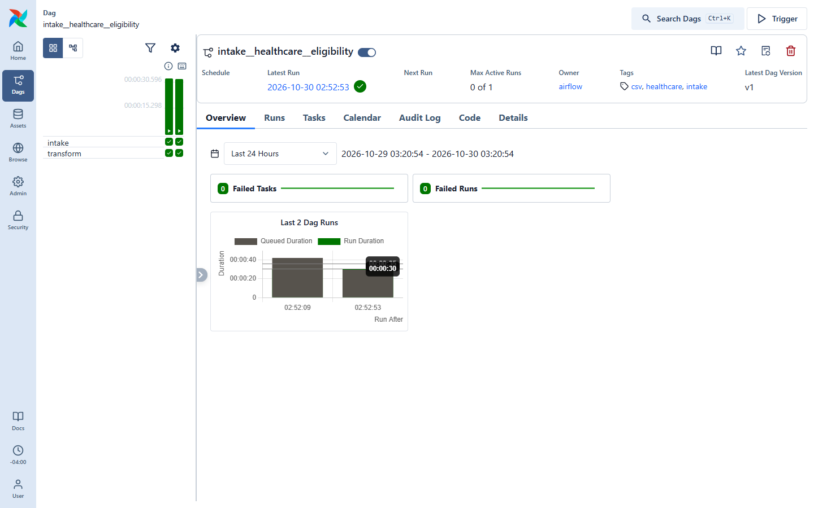
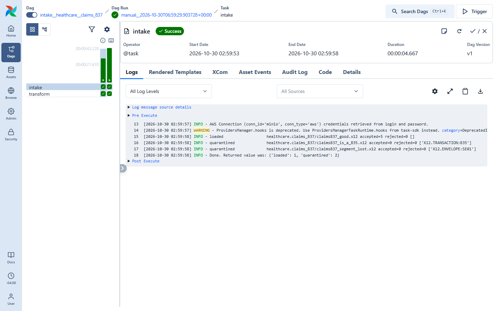
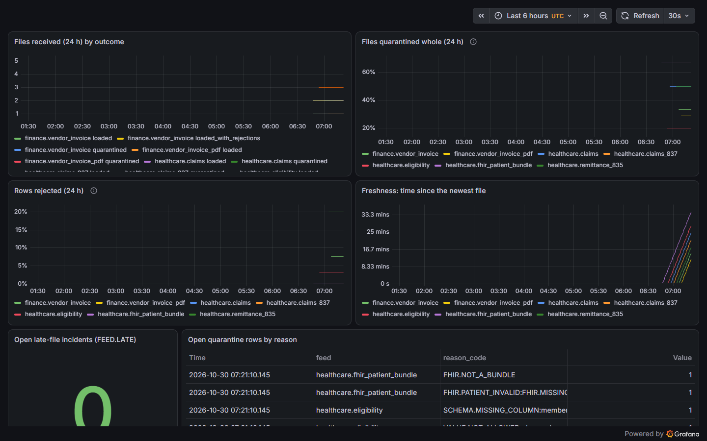
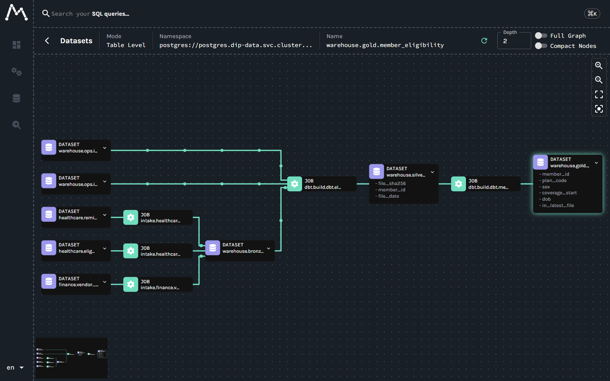
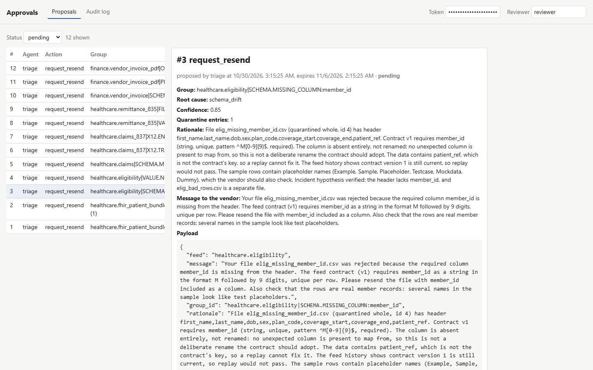
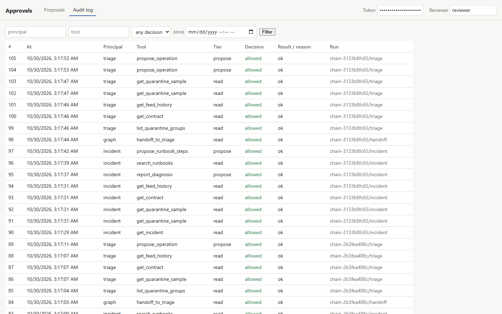

# Data Intake Platform

**Reviewing this for a clinical research informatics or data engineering role? Start with
[docs/FOR_REVIEWERS.md](docs/FOR_REVIEWERS.md)**: each thing these roles ask for mapped to the
file, the PR and the result, a two-minute tour, and an architecture diagram.

A free, enterprise-style platform for vendor and partner files that arrive late, change
format, or contain bad records. Files are checked against YAML data contracts, then
either flow through bronze, silver, and gold layers (dbt on Postgres) or land in
quarantine with a machine-readable reason. Lineage, data quality, and metrics are
built in, and AI agents propose fixes and contracts, but a person always approves them.

## What it looks like

From one local run on 2026-10-30 (Stage 9): `scripts/up.sh` with the observability profile
and a model key, the smoke test and the E2E (which stopped at its `agent_chain` check, written
for CI's no-key setup and fixed since; the later stages pass in CI), then these six screens
(`scripts/screenshots.py`; every value is synthetic or invented). With the key, the
`agent_chain` DAG ran the incident -> triage chain on its own, as pods Airflow launched:
7 incidents diagnosed, 12 proposals filed, no group twice, all waiting for a
person ([docs/demos/stage-9.md](docs/demos/stage-9.md)).

**An intake DAG in Airflow.** The eligibility feed's DAG (`intake` then dbt `transform`, one
pod per task) and its runs from the E2E.



**Quarantined files and their reason codes.** The 837P claims feed's intake task log: one
file loaded, and two quarantined whole, one an 835 sent to the 837 feed
(`X12.TRANSACTION:835`), one with a segment lost in transfer (`X12.ENVELOPE:SE01`).



**Feed health in Grafana.** Files by outcome, files quarantined whole, rows rejected,
freshness per feed, late-file incidents, and the open quarantine by reason code.



**Lineage in Marquez.** `gold.member_eligibility` back through silver, the dbt jobs and
`bronze.csv_record` to the intake jobs and the files they read.



**Agent proposals waiting for a person.** The approvals page (Stage 9): the triage agent's
proposals, filed by the unattended chain (`claude-haiku-5-5`, through the in-cluster MCP
server with its own key), one per group it covered, with the rationale and the message it
would send the vendor. Nothing happens until a person approves, and the page cannot run
anything: its database login can only record the decision.



**Every call, audited.** The same page's audit log: one chain (`chain-...`) from the
incident agent's diagnosis and runbook search, through the code-checked handoff, to the
triage agent's proposals.



See [PLAN.md](PLAN.md) for the architecture, decisions, and staged roadmap.

**Status (PLAN.md §8.9 has the item-by-item check).** Built and merged: Stage 0
foundations; Stage 1 (CSV through raw, contract, bronze, silver, gold, with the E2E);
Stage 2 (Excel, SFTP, the intake API, claims, finance invoices, late-file incidents);
Stage 3 (PDF invoices with OCR, Prometheus and Grafana, Marquez lineage, the MCP Read tier
deployed); Stage 5 (the contract-author agent and its evals); the failure-triage agent
with human approval; Stage 4 (synthetic 837P/835 X12 into claims and remittance marts,
`dip break`, 8 runbooks, and the break-and-fix loop for every scenario); Stage 6 (the triage
agent runs an operation only after a person approved it); Stage 7 (incidents from
breakages, the incident agent, and a LangGraph chain that hands quarantined records to
triage through a typed edge decided in code); the research-data track R1–R7a and M1–M3.
Stage 8 in part: nightly evals that replay every agent's recordings, and a recorded
demo of the whole chain (`bash scripts/demo.sh`: no API key, a throwaway Postgres in
Docker; [docs/demos/stage-8.md](docs/demos/stage-8.md)). Stage 9: the incident -> triage
chain as Airflow-launched pods, the approvals page and audit viewer, runbook steps from the
incident agent, 12 `dip break` scenarios, one open proposal per group, and audit rows that
name their approval and chain; the screenshots above are from its run
([docs/demos/stage-9.md](docs/demos/stage-9.md)). Demos: [docs/demos](docs/demos/).
Agents and their evals: [docs/agents/EVALS.md](docs/agents/EVALS.md). Research track (see
[docs/research](docs/research/README.md)):

| | |
|---|---|
| R1 | Synthea FHIR R4 through the intake: data contract, sha256 raw copy, quarantine with reason codes |
| R2 | dbt gold layer as OMOP CDM 5.4 (person, observation_period, visit, condition, measurement, drug_exposure, observation, procedure) |
| R3 | OMOP data quality: dbt tests named after OHDSI DQD checks, results in `ops.dq_results` |
| R4 | De-identified shareable tier (keyed pseudonyms, date shifting, top-coding) with Postgres-enforced access |
| R5 | Versioned Frictionless extracts, proven byte-identical across independent rebuilds |
| R6 | OpenLineage events from intake, dbt and extracts; the intake and dbt events reach Marquez in the cluster (Stage 3) |
| R7a | A governed cohort library over the shareable tier: a read-only role granted it only for synthetic data, small-cell suppression, a hash-chained audit ([docs/research/cohort-service.md](docs/research/cohort-service.md)) |
| M1 | MIMIC-IV FHIR demo (Bulk Data) through the FHIR intake into OMOP, with a report of what breaks against Synthea |
| M2 | MIMIC-IV relational demo through a relational-tables-to-OMOP path (per-table contracts) |
| M3 | Reconciliation of the two MIMIC OMOP builds by source keys: 0 unexplained differences |
| V1–V3 | Full local Athena vocabulary (one bundle, never committed) and MIT-LCP's MIMIC lab → LOINC map: Synthea 6.8% → 0.1% of rows unmapped, MIMIC diagnoses 100% → 3.3%; details in [docs/research/vocabulary.md](docs/research/vocabulary.md) |

**Data.** Everything committed, and everything CI runs on, is synthetic (Synthea and
hand-written fixtures). Separately, two public **real, de-identified** datasets, the
MIMIC-IV demos from PhysioNet (ODbL), can be downloaded and run **locally only**. They are
never committed, and only aggregate results are published. See
[docs/research/mimic.md](docs/research/mimic.md).

## Quick start

Prerequisites: Docker (with about 8 GiB of memory available), kind, Terraform and kubectl.
Helm is optional, for debugging only. Check with:

```bash
bash scripts/prereqs.sh
```

Bring the stack up, run the smoke test, and tear it down. On Windows, run these from
Git Bash; `make up` and the other targets work where `make` is installed.

```bash
bash scripts/up.sh       # kind cluster and the stack; the first run builds four images
bash scripts/smoke.sh    # end-to-end smoke test
bash scripts/creds.sh    # local credentials
bash scripts/down.sh     # delete everything
```

| Service | URL |
|---|---|
| Airflow UI | http://localhost:8080 (user `admin`) |
| MinIO console | http://localhost:9001 |
| MinIO S3 API | http://localhost:9000 |
| Postgres (warehouse) | `localhost:15432` |

All ports are bound to `127.0.0.1` only. The SFTP server, the intake API, the MCP server,
and (observability profile) Prometheus, Grafana and Marquez are ClusterIP services: reach
them with `kubectl port-forward` (docs/observability.md, docs/agents/mcp-read.md).

Measured once on a 16 GB laptop: `up.sh`, the smoke test and the full E2E together take
about 34 minutes on a first run, with the kind node at 3.3 GiB
([docs/demos/stage-3.md](docs/demos/stage-3.md)). Checked again from a fresh clone on
2026-10-23 with the observability profile (`TF_VAR_profiles='["core", "observability"]'`):
`up.sh` took 9 minutes (Docker already had the images' layers cached), the smoke test passed,
and the E2E passed every stage up to the last, which was stopped for low memory; see
[docs/demos/stage-8.md](docs/demos/stage-8.md#the-fresh-clone-quickstart). With both
profiles, the laptop's available memory fell from 3.2 GB to about 150 MB during the E2E:
start with at least 4 GB free.

## What runs where

| Namespace | Component | Notes |
|---|---|---|
| `dip-airflow` | Airflow 3.2.2 (official Helm chart 1.22.0) | KubernetesExecutor: every task is its own pod; task logs go to MinIO |
| `dip-data` | Postgres 17 | Shared instance with `airflow`, `warehouse` (bronze, silver, gold, ops schemas) and `marquez` databases |
| `dip-data` | MinIO | Buckets: `landing`, `raw`, `quarantine`, `airflow-logs` |
| `dip-data` | SFTP server, intake API | Vendor channels (Stage 2) |
| `dip-data` | MCP server | The `reader`, `triage` and `incident` agents' door: Read, Propose and Act tiers behind per-agent keys and policies (Stages 3 to 7) |
| `dip-data` | Approvals page | Proposals to approve or reject, and the audit log, in a browser (Stage 9, S9.2): `kubectl -n dip-data port-forward svc/approvals 8081`, then http://127.0.0.1:8081 with the token from `terraform output -raw approvals_token`. Its own login (`dip_approver`) can decide but never execute |
| `dip-airflow` | `agent_chain` DAG | Every 5 minutes, the incident -> triage chain on open incidents, each run its own pod with resource limits (Stage 9, S9.1). Claims are recorded in `ops.agent_run`; with no model key in the `dip-agent-chain` Secret (Terraform `anthropic_api_key` / `gemini_api_key`, default empty) it claims nothing and the DAG stays green, so incidents wait for a key; a claim a dead pod left `running` is taken back after 30 minutes |
| `dip-obs` | Prometheus, Grafana, Marquez | The `observability` profile only (Stage 3) |

## Repo layout

```
dip/                 the platform: intake, contracts, CSV/Excel/PDF/FHIR readers, de-id,
                     extracts, lineage, metrics, cohorts, agents (dip/agents/)
dags/                Airflow DAGs (one per contract, FHIR, SFTP sync, late files)
dbt/                 bronze → silver → gold, OMOP CDM 5.4, the shareable tier, DQ tests
packs/               contracts, generators and cohorts per domain (healthcare, finance, mimic)
agents/              agent policies, prompts, eval cases and recordings
infra/terraform/     kind cluster and every service; infra/helm-values/ for the charts
images/              Airflow, OCR, intake API and MCP server images
observability/       Prometheus alert rules and their tests; Grafana dashboards
tests/               unit, Postgres integration, and end-to-end (tests/e2e/) tests
scripts/             up, down, smoke, e2e, creds, diagnostics, prereqs
config/              LLM configuration
docs/                contracts, research track, agents, runbooks, observability, demos
```

## CI

- `ci` workflow: ruff, shellcheck, Terraform fmt and validate, unit tests, Postgres
  integration tests, and a fresh Synthea export pushed through the intake.
- `e2e` workflow: creates a kind cluster with Terraform on a GitHub runner, deploys the
  stack with the observability profile, and runs the end-to-end tests (file feeds, FHIR,
  metrics, lineage, the MCP Read tier) on every push and pull request.
- `upgrade` workflow: deploys the previous `main`, loads data, upgrades in place, and runs
  the E2E again (on PRs that change dbt, infra (Terraform, Helm values), images, the
  warehouse SQL or up.sh; nightly; and on demand).
- The agent evals replay recorded model turns: CI never calls a model.

CI uses synthetic data only (Synthea, and generated or hand-written fixtures). The MIMIC-IV
demos are never downloaded in CI, and no real or MIMIC data is ever sent to a model
provider.

## Data sources and citations

| Source | Kind | License | Where it runs |
|---|---|---|---|
| [Synthea](https://github.com/synthetichealth/synthea) v4.0.0 | synthetic | Apache-2.0 (tool); extracts CC0-1.0 | CI and local |
| [OHDSI Eunomia](https://github.com/OHDSI/EunomiaDatasets) Synthea27Nj vocabulary shard | OMOP vocabulary subset | Apache-2.0 | CI and local |
| [OHDSI Athena](https://athena.ohdsi.org) full vocabularies (SNOMED, LOINC, RxNorm, ICD10CM, ...) | OMOP vocabulary | per vocabulary, licensed to the downloader | local only, never committed |
| [MIT-LCP mimic-code](https://github.com/MIT-LCP/mimic-code) v2.4.0 `d_labitems_to_loinc.csv` | MIMIC lab item → LOINC map | MIT | local (fetched pinned, with MIMIC) |
| [MIMIC-IV Clinical Database Demo on FHIR](https://physionet.org/content/mimic-iv-fhir-demo/2.1.0/) v2.1.0 | **real, de-identified** | ODbL v1.0 | local only |
| [MIMIC-IV Clinical Database Demo](https://physionet.org/content/mimic-iv-demo/2.2/) v2.2 | **real, de-identified** | ODbL v1.0 | local only |

When using the MIMIC-IV demos, cite:

- Bennett, A., Ulrich, H., Wiedekopf, J., Szul, P., Grimes, J., & Johnson, A. (2025).
  MIMIC-IV Clinical Database Demo on FHIR (version 2.1.0). PhysioNet. RRID:SCR_007345.
  https://doi.org/10.13026/vphg-y548
- Bennett AM, Ulrich H, van Damme P, Wiedekopf J, Johnson AE. MIMIC-IV on FHIR: converting a
  decade of in-patient data into an exchangeable, interoperable format. JAMIA.
  2023;30(4):718-25. https://doi.org/10.1093/jamia/ocad002
- Johnson, A., Bulgarelli, L., Pollard, T., Horng, S., Celi, L. A., & Mark, R. (2023).
  MIMIC-IV Clinical Database Demo (version 2.2). PhysioNet. RRID:SCR_007345.
  https://doi.org/10.13026/dp1f-ex47
- Johnson, A., Bulgarelli, L., Pollard, T., Celi, L. A., Horng, S., & Mark, R. (2023).
  MIMIC-IV-ED Demo (version 2.2). PhysioNet. RRID:SCR_007345.
  https://doi.org/10.13026/jzz5-vs76
- The lab item → LOINC map: MIT Laboratory for Computational Physiology, mimic-code
  v2.4.0, `mimic-iv/concepts/concept_map/d_labitems_to_loinc.csv` (MIT license).
  https://github.com/MIT-LCP/mimic-code
- Pollard, T., Moody, B. E., Lehman, L., Gow, B., Fernandes, C., Xie, C., Johnson, A.,
  Mark, R. G., & Heldt, T. (2026). PhysioNet as a global platform for biomedical research.
  Nature Health. https://doi.org/10.1038/s44360-026-00096-z
