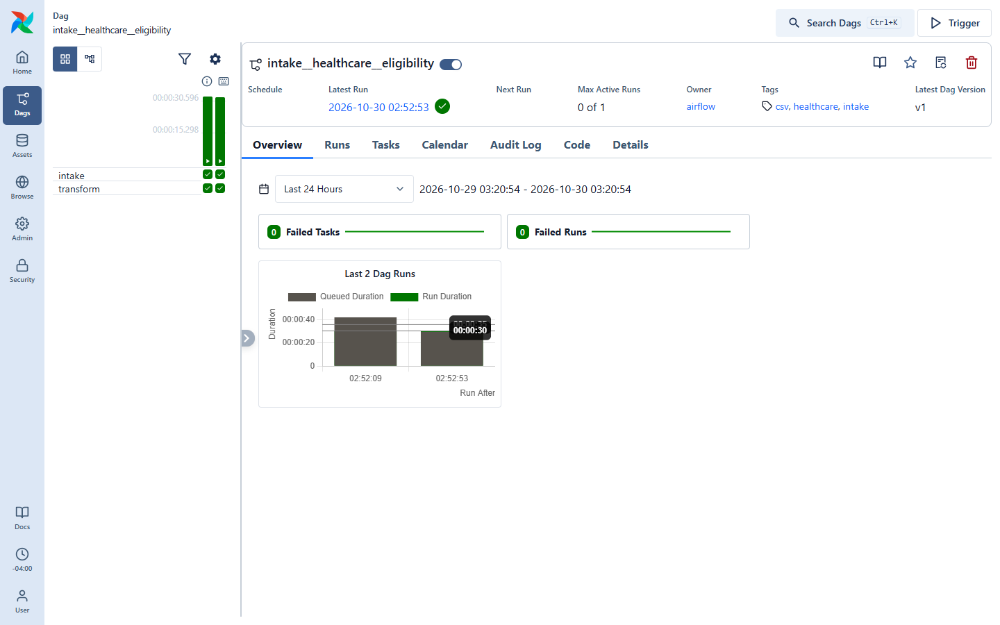
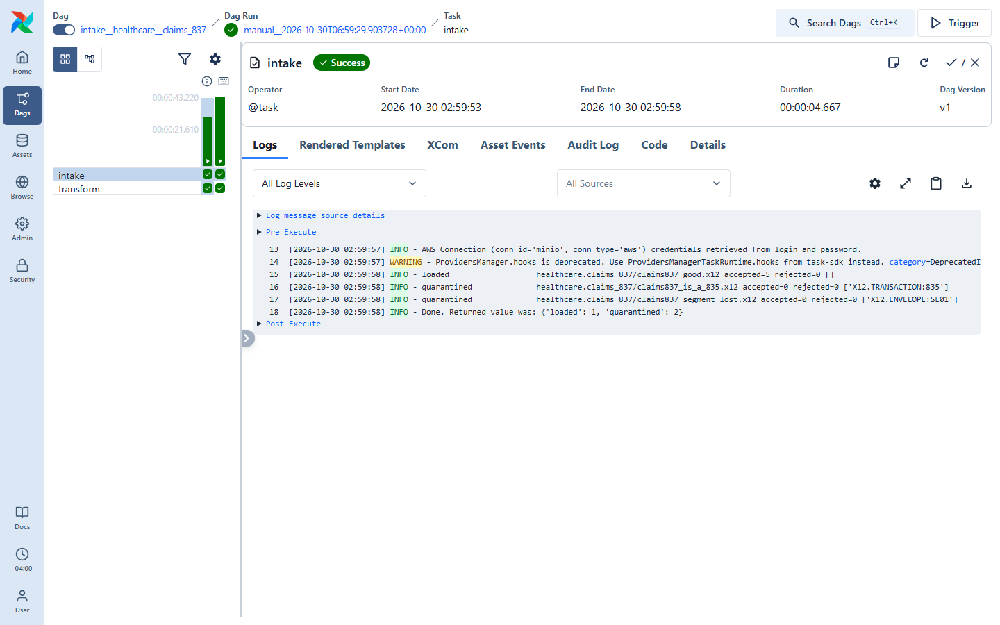
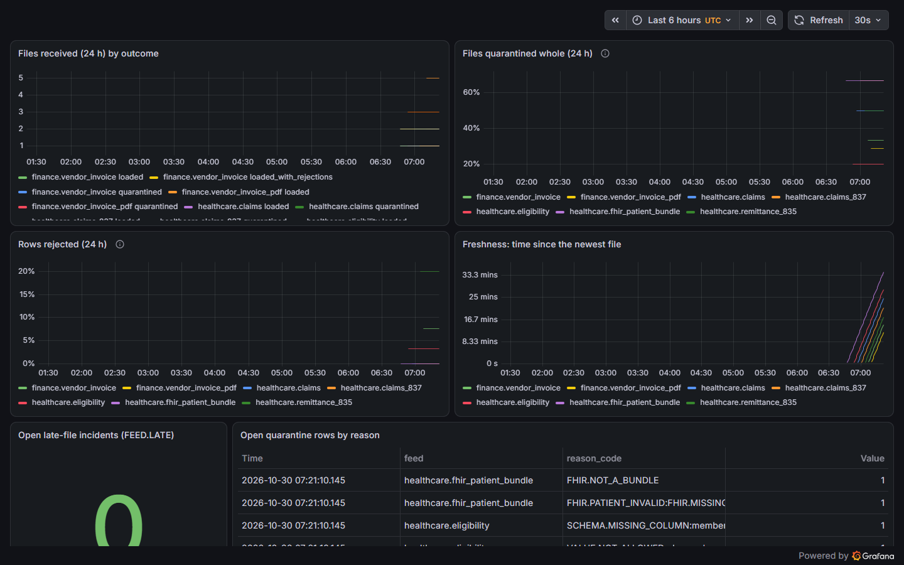
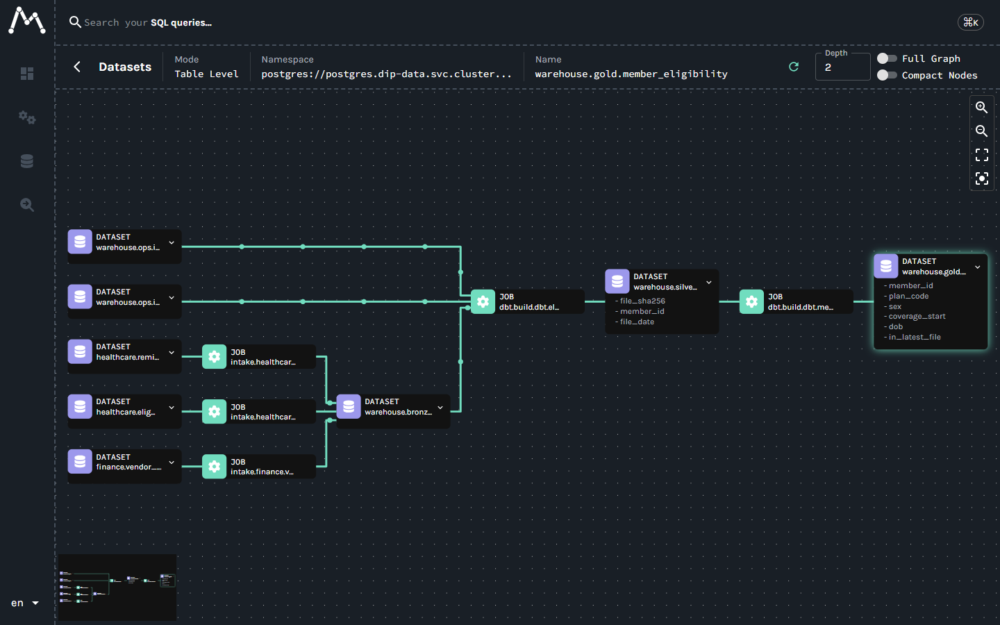
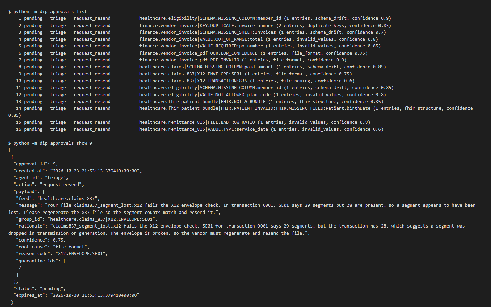
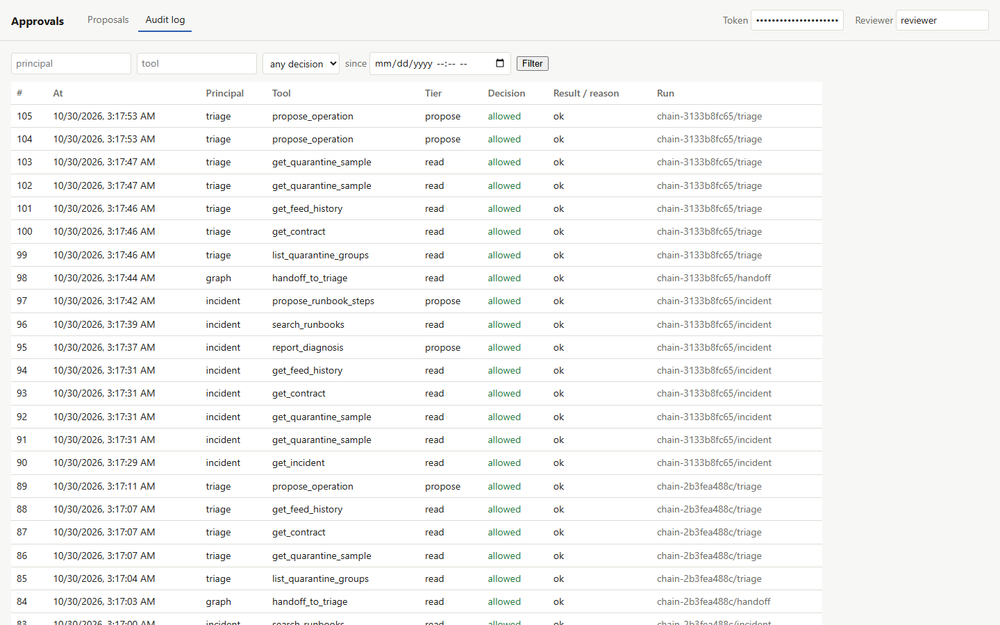
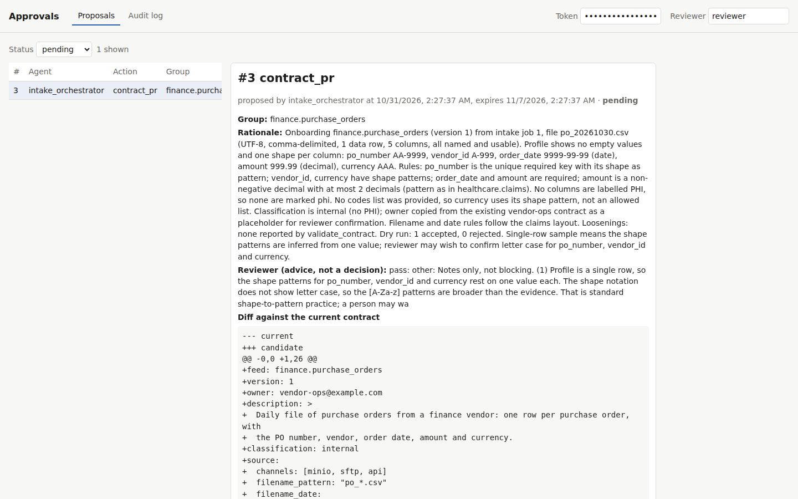
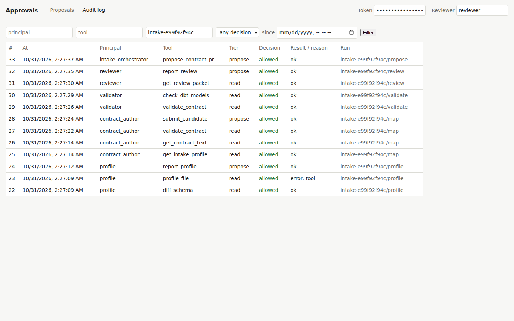

# Data Intake Platform

**Reviewing this for a clinical research informatics or data engineering role? Start with
[docs/FOR_REVIEWERS.md](docs/FOR_REVIEWERS.md)**: each thing these roles ask for mapped to the
file, the PR and the result, a two-minute tour, and an architecture diagram. The design on one
page, with how it scales, where it breaks and its main trade-offs:
[docs/ARCHITECTURE.md](docs/ARCHITECTURE.md).
A three-minute walkthrough to record: [docs/demos/walkthrough.md](docs/demos/walkthrough.md).

A free, enterprise-style platform for vendor and partner files that arrive late, change
format, or contain bad records. Files are checked against YAML data contracts, then
either flow through bronze, silver, and gold layers (dbt on Postgres) or land in
quarantine with a machine-readable reason. Lineage, data quality, and metrics are
built in, and AI agents propose fixes and contracts, but a person always approves them.

It **runs on Kubernetes locally**: a kind cluster on one laptop, built by Terraform, and the
same cluster on a GitHub runner in CI. Nothing is deployed to a cloud host.

## What it looks like

From one local run on 2026-10-30 (Stage 9): `scripts/up.sh` with the observability profile
and a model key, the smoke test and the E2E (which stopped at its `agent_chain` check, written
for CI's no-key setup and fixed since; the later stages pass in CI), then these six screens
(`scripts/screenshots.py`; every value is synthetic or invented). With the key, the
`agent_chain` DAG ran the incident -> triage chain on its own, as pods Airflow launched:
7 incidents diagnosed, 12 proposals filed, no group twice, all waiting for a
person ([docs/demos/stage-9.md](docs/demos/stage-9.md)).

**An intake DAG in Airflow.** The eligibility feed's DAG (`intake` then dbt `transform`, one
pod per task) and its runs from the E2E.



**Quarantined files and their reason codes.** The 837P claims feed's intake task log: one
file loaded, and two quarantined whole, one an 835 sent to the 837 feed
(`X12.TRANSACTION:835`), one with a segment lost in transfer (`X12.ENVELOPE:SE01`).



**Feed health in Grafana.** Files by outcome, files quarantined whole, rows rejected,
freshness per feed, late-file incidents, and the open quarantine by reason code.



**Lineage in Marquez.** `gold.member_eligibility` back through silver, the dbt jobs and
`bronze.csv_record` to the intake jobs and the files they read.



**Agent proposals waiting for a person.** The approvals page (Stage 9): the triage agent's
proposals, filed by the unattended chain (`claude-haiku-5-5`, through the in-cluster MCP
server with its own key), one per group it covered, with the rationale and the message it
would send the vendor. Nothing happens until a person approves, and the page cannot run
anything: its database login can only record the decision.



**Every call, audited.** The same page's audit log: one chain (`chain-...`) from the
incident agent's diagnosis and runbook search, through the code-checked handoff, to the
triage agent's proposals.



**A new vendor's feed, proposed by the intake team (Stage 10).** From the S10.6 proof (the
manual `proof` workflow on a GitHub runner, 2026-10-31): a sample of an unknown
`finance.purchase_orders` feed was dropped under `landing/_onboard/`. The profile, map
(contract author), validate and review steps ran under one chain id, and the
orchestrator proposed the contract with the reviewer's verdict beside it as advice. A
person approved, `dip approvals execute` wrote the branch with the contract and its
generated dbt models, and `dbt build` passed on them (11 of 11). Model spend: $0.0074
([docs/demos/stage-10.md](docs/demos/stage-10.md)).



The same run in the audit log, filtered to its chain id: each of the 12 calls, by the profile,
contract author, validator, reviewer and orchestrator, with its tier and decision. Eight are
Read tier; the four Propose-tier calls record a step's result, and the last,
`propose_contract_pr` (call 33), files the proposal, which waits for a person.



See [PLAN.md](PLAN.md) for the architecture, decisions, and staged roadmap.

**Status (PLAN.md §8.9 has the item-by-item check).** Built and merged: Stage 0
foundations; Stage 1 (CSV through raw, contract, bronze, silver, gold, with the E2E);
Stage 2 (Excel, SFTP, the intake API, claims, finance invoices, late-file incidents);
Stage 3 (PDF invoices with OCR, Prometheus and Grafana, Marquez lineage, the MCP Read tier
deployed); Stage 5 (the contract-author agent and its evals); the failure-triage agent
with human approval; Stage 4 (synthetic 837P/835 X12 into claims and remittance marts,
`dip break`, 8 runbooks, and the break-and-fix loop for every scenario); Stage 6 (the triage
agent runs an operation only after a person approved it); Stage 7 (incidents from
breakages, the incident agent, and a LangGraph chain that hands quarantined records to
triage through a typed edge decided in code); the research-data track R1–R7a and M1–M3.
Stage 8 in part: nightly evals that replay every agent's recordings, and a recorded
demo of the whole chain (`bash scripts/demo.sh`: no API key, a throwaway Postgres in
Docker; [docs/demos/stage-8.md](docs/demos/stage-8.md)). Stage 9: the incident -> triage
chain as Airflow-launched pods, the approvals page and audit viewer, runbook steps from the
incident agent, 12 `dip break` scenarios, one open proposal per group, and audit rows that
name their approval and chain; the screenshots above are from its run
([docs/demos/stage-9.md](docs/demos/stage-9.md)). Demos: [docs/demos](docs/demos/).
Agents and their evals: [docs/agents/EVALS.md](docs/agents/EVALS.md). Research track (see
[docs/research](docs/research/README.md)):

| | |
|---|---|
| R1 | Synthea FHIR R4 through the intake: data contract, sha256 raw copy, quarantine with reason codes |
| R2 | dbt gold layer as OMOP CDM 5.4 (person, observation_period, visit, condition, measurement, drug_exposure, observation, procedure) |
| R3 | OMOP data quality: dbt tests named after OHDSI DQD checks, results in `ops.dq_results` |
| R4 | De-identified shareable tier (keyed pseudonyms, date shifting, top-coding) with Postgres-enforced access |
| R5 | Versioned Frictionless extracts, proven byte-identical across independent rebuilds |
| R6 | OpenLineage events from intake, dbt and extracts; the intake and dbt events reach Marquez in the cluster (Stage 3) |
| R7a | A governed cohort library over the shareable tier: a read-only role granted it only for synthetic data, small-cell suppression, a hash-chained audit ([docs/research/cohort-service.md](docs/research/cohort-service.md)) |
| M1 | MIMIC-IV FHIR demo (Bulk Data) through the FHIR intake into OMOP, with a report of what breaks against Synthea |
| M2 | MIMIC-IV relational demo through a relational-tables-to-OMOP path (per-table contracts) |
| M3 | Reconciliation of the two MIMIC OMOP builds by source keys: 0 unexplained differences |
| V1–V3 | Full local Athena vocabulary (one bundle, never committed) and MIT-LCP's MIMIC lab → LOINC map: Synthea 6.8% → 0.1% of rows unmapped, MIMIC diagnoses 100% → 3.3%; details in [docs/research/vocabulary.md](docs/research/vocabulary.md) |

**Data.** Everything committed, and everything CI runs on, is synthetic (Synthea and
hand-written fixtures). Separately, two public **real, de-identified** datasets, the
MIMIC-IV demos from PhysioNet (ODbL), can be downloaded and run **locally only**. They are
never committed, and only aggregate results are published. See
[docs/research/mimic.md](docs/research/mimic.md).

## Quick start

Prerequisites: Docker (with about 8 GiB of memory available), kind, Terraform and kubectl.
Helm is optional, for debugging only. Check with:

```bash
bash scripts/prereqs.sh
```

Bring the stack up, run the smoke test, and tear it down. On Windows, run these from
Git Bash; `make up` and the other targets work where `make` is installed.

```bash
bash scripts/up.sh       # kind cluster and the stack; the first run builds four images
bash scripts/smoke.sh    # end-to-end smoke test
bash scripts/creds.sh    # local credentials
bash scripts/down.sh     # delete everything
```

| Service | URL |
|---|---|
| Airflow UI | http://localhost:8080 (user `admin`) |
| MinIO console | http://localhost:9001 |
| MinIO S3 API | http://localhost:9000 |
| Postgres (warehouse) | `localhost:15432` |

All ports are bound to `127.0.0.1` only. The SFTP server, the intake API, the MCP server,
and (observability profile) Prometheus, Grafana and Marquez are ClusterIP services: reach
them with `kubectl port-forward` (docs/observability.md, docs/agents/mcp-read.md).

Measured once on a 16 GB laptop: `up.sh`, the smoke test and the full E2E together take
about 34 minutes on a first run, with the kind node at 3.3 GiB
([docs/demos/stage-3.md](docs/demos/stage-3.md)). Checked again from a fresh clone on
2026-10-23 with the observability profile (`TF_VAR_profiles='["core", "observability"]'`):
`up.sh` took 9 minutes (Docker already had the images' layers cached), the smoke test passed,
and the E2E passed every stage up to the last, which was stopped for low memory; see
[docs/demos/stage-8.md](docs/demos/stage-8.md#the-fresh-clone-quickstart). With both
profiles, the laptop's available memory fell from 3.2 GB to about 150 MB during the E2E:
start with at least 4 GB free.

### WSL2 memory on Windows

On Windows, Docker Desktop runs in WSL2, and WSL2's memory cap is the memory Docker (and so
the kind node) can use. Without a cap WSL2 may take up to half the RAM and keeps its page
cache, which starves Windows; with too low a cap the kind node is OOM-killed. Set it in
`%USERPROFILE%\.wslconfig` (create the file if it is not there). For a 16 GB laptop:

```ini
[wsl2]
# Docker sees about 8 GiB: the core profile needs about 4.5 GiB plus headroom
memory=9GB
swap=4GB
# your core count, or fewer
processors=8
```

Then run `wsl --shutdown` from PowerShell and restart Docker Desktop for it to take effect.
`bash scripts/prereqs.sh` prints the `memory=` it finds, and the memory Docker reports.

The 16 GB numbers are measured (the paragraph above); the others are a starting point, not
tested here:

- **8 GB laptop:** `memory=5GB` and the core profile only (the default). The full E2E may
  not fit; it also runs on a GitHub runner on every push (the `e2e` workflow).
- **32 GB laptop:** `memory=16GB` leaves room for both profiles.
- **Done for the day:** `bash scripts/down.sh` deletes the cluster; quitting Docker Desktop
  (or `wsl --shutdown`) gives the memory back to Windows.

## What runs where

| Namespace | Component | Notes |
|---|---|---|
| `dip-airflow` | Airflow 3.4.0 (official Helm chart 1.22.0) | KubernetesExecutor: every task is its own pod; task logs go to MinIO |
| `dip-data` | Postgres 17 | Shared instance with `airflow`, `warehouse` (bronze, silver, gold, ops schemas) and `marquez` databases |
| `dip-data` | MinIO | Buckets: `landing`, `raw`, `quarantine`, `airflow-logs` |
| `dip-data` | SFTP server, intake API | Vendor channels (Stage 2) |
| `dip-data` | MCP server | The `reader`, `triage` and `incident` agents' door: Read, Propose and Act tiers behind per-agent keys and policies (Stages 3 to 7) |
| `dip-data` | Approvals page | Proposals to approve or reject, and the audit log, in a browser (Stage 9, S9.2): `kubectl -n dip-data port-forward svc/approvals 8081`, then http://127.0.0.1:8081 with the token from `terraform output -raw approvals_token`. Its own login (`dip_approver`) can decide but never execute |
| `dip-airflow` | `agent_chain` DAG | Every 5 minutes, the incident -> triage chain on open incidents, each run its own pod with resource limits (Stage 9, S9.1). Claims are recorded in `ops.agent_run`; with no model key in the `dip-agent-chain` Secret (Terraform `anthropic_api_key` / `gemini_api_key`, default empty) it claims nothing and the DAG stays green, so incidents wait for a key; a claim a dead pod left `running` is taken back after 30 minutes |
| `dip-obs` | Prometheus, Grafana, Marquez | The `observability` profile only (Stage 3) |

## Repo layout

```
dip/                 the platform: intake, contracts, CSV/Excel/PDF/FHIR readers, de-id,
                     extracts, lineage, metrics, cohorts, agents (dip/agents/)
dags/                Airflow DAGs (one per contract, FHIR, SFTP sync, late files)
dbt/                 bronze → silver → gold, OMOP CDM 5.4, the shareable tier, DQ tests
packs/               contracts, generators and cohorts per domain (healthcare, finance, mimic)
agents/              agent policies, prompts, eval cases and recordings
infra/terraform/     kind cluster and every service; infra/helm-values/ for the charts;
                     infra/helm-charts/ holds the Airflow chart (its README: how to update it)
images/              Airflow, OCR, intake API and MCP server images
observability/       Prometheus alert rules and their tests; Grafana dashboards
tests/               unit, Postgres integration, and end-to-end (tests/e2e/) tests
scripts/             up, down, smoke, e2e, creds, diagnostics, prereqs
config/              LLM configuration
docs/                contracts, research track, agents, runbooks, observability, demos
```

## CI

- `ci` workflow: ruff, shellcheck, Terraform fmt and validate, unit tests, Postgres
  integration tests, and a fresh Synthea export pushed through the intake.
- `e2e` workflow: creates a kind cluster with Terraform on a GitHub runner, deploys the
  stack with the observability profile, and runs the end-to-end tests (file feeds, FHIR,
  metrics, lineage, the MCP Read tier) on every push and pull request.
- `upgrade` workflow: deploys the previous `main`, loads data, upgrades in place, and runs
  the E2E again (on PRs that change dbt, infra (Terraform, Helm values), images, the
  warehouse SQL or up.sh; nightly; and on demand).
- The agent evals replay recorded model turns: CI never calls a model.
- `evals` workflow (nightly): every agent's recorded evals replay against Postgres; the run
  fails on any failed case, or on any eval that started but wrote no report.

## Production readiness

What is in place, and where to check it, for a platform that runs on Kubernetes locally
(kind). Ticked lines are built and point at their proof; unticked lines are **not yet
built** and name the [docs/BACKLOG.md](docs/BACKLOG.md) item that builds them.
[docs/PROGRESS.md](docs/PROGRESS.md) has a line for each finished item.

**Deployment**

- [x] Infrastructure as code: Terraform builds the kind cluster and every service
  (`infra/terraform/`); `terraform fmt -check` and `terraform validate` in the `ci` lint job
- [x] Helm: Airflow, Prometheus and Grafana from their official charts
  (`infra/helm-values/`)
- [x] A fresh cluster on every push and pull request: the `e2e` workflow builds kind with
  Terraform and runs `tests/e2e/`
- [x] The kind E2E's break loop and platform drill do not depend on the clock: the resend
  carries the quarantined file's business date, and the drill's check Job has no CronJob
  owner to prune it (`tests/e2e/break_loop.py`, `tests/e2e/platform_drill.py`; 12.2)
- [x] The Airflow chart is committed and checksummed, so a deploy downloads no Airflow
  chart (`infra/helm-charts/`, `tests/unit/test_helm_charts.py`; incident 2026-11-06 in
  `docs/incidents.md`)
- [x] Upgrades in place: the `upgrade` workflow deploys the previous `main`, loads data,
  upgrades and runs the E2E again; Airflow's own migration Job (`migrateDatabaseJob` in
  `infra/helm-values/airflow.yaml`)
- [x] Readiness probes on 8 of the 9 long-running workloads Terraform deploys (all but
  `marquez-web`); the Helm charts bring their own
- [x] Kubernetes Secrets for every credential, generated by Terraform (`random_password`
  in `infra/terraform/`); the `bad_secret` drill (runbook 11)
- [x] No password in any Job's spec: MinIO root and new users' passwords come from Secrets
  (`infra/terraform/minio.tf`, `tests/unit/test_job_secrets.py`; 24.13)
- [x] Airflow pods hold no master secret: Airflow's own MinIO user limited to its four buckets,
  and the de-identification and SFTP keys only in the one task pod that uses each
  (`infra/terraform/airflow.tf`, `tests/unit/test_airflow_secrets.py`; 24.2)
- [x] Liveness and readiness probes on every long-running service (`tests/unit/test_probes.py`; 13.1)
- [x] Rolling updates with `maxUnavailable: 0` and `dip rollback SERVICE`; the kind E2E rolls
  the intake API out and back without dropping below one available pod (`dip/rollback.py`,
  `tests/e2e/rollback.py`; 13.2)
- [ ] A bad-release drill with its runbook and incident eval case: not yet built (13.3). The
  drill, its incident and the `ReleaseStalled` alert run in the kind E2E today
- [x] Autoscaling: metrics-server and HPAs on the intake API and the MCP server, 1 to 3 pods
  and back, proved in the proof workflow's `scaling` job (`infra/terraform/autoscaling.tf`,
  `scripts/proof_scaling.py`; 13.4)
- [ ] OpenTofu checked in CI: not yet built (13.5)
- [x] Dependency updates (`.github/dependabot.yml`), Trivy scans of every image we build,
  failing on a fixable CRITICAL (`.github/workflows/security.yml`, `.trivyignore`), and
  CodeQL for Python and the workflows (`.github/workflows/codeql.yml`; 12.9); Dependabot
  alerts and grouped security updates, and private vulnerability reporting, on in the repo's
  settings (24.7). Branch protection on `main`: `lint`, `test`, `e2e`, `trivy` and both CodeQL
  analyses required, for admins too, with force pushes and deletion blocked; requiring a pull
  request is still the owner's step (24.6, `docs/OWNER_STEPS.md`)
- [x] The intake API serves no OpenAPI schema or docs pages (`dip/intake_api.py`; 24.34)
- [x] Credential files (`*.p12`, any secrets folder, credential JSON, `.netrc`) are gitignored (24.26)
- [x] No `${{ }}` expression inlined into a workflow's shell script
  (`tests/unit/test_workflow_expressions.py`; 24.25)
- [x] Private vulnerability reporting, and a `SECURITY.md` that points to it (24.24)
- [x] The SFTP sync refuses unsafe names and files over 50 MiB before reading them
  (`dip/sftp_sync.py`; 24.36)
- [x] The platform's own image bases and Terraform's image defaults pinned by digest
  (`tests/unit/test_image_digests.py`; 24.22). The Prometheus and Grafana charts still pull
  their default images by tag
- [x] Locked, hashed Python installs with a 7-day release cooldown in CI, the proof jobs and
  every image (`requirements/`, `scripts/lock.py`, `tests/unit/test_locks.py`; 24.4)
- [x] Every GitHub Action pinned by commit SHA, its version in a comment (`tests/unit/test_actions_pinned.py`; 24.5)
- [x] Claude Code project settings: a deny list (secrets, force pushes, tags, pushes to
  `main`) and asks for installs and destructive commands (`.claude/settings.json`; 24.42)
- [x] Dependabot proposes only versions public for 7 days, and raises pins without widening
  them (`.github/dependabot.yml`; 24.23)
- [x] No open code scanning or Dependabot alert: paramiko 5.1 everywhere (the version Airflow
  runs), and the three CodeQL alerts traced and dismissed with their reasons (24.43)
- [ ] A CI gate on misconfigurations in `infra/`: not yet built (24.40). Today Trivy's checks
  run report-only on every pull request, push to `main` and weekly (`security.yml`'s `iac`
  job), over the Terraform files and the vendored Helm charts at their default values
- [x] Versioned releases: a `v*` tag builds the four images, pushes them to GHCR tagged with
  the version and the commit, and publishes a GitHub release with notes from
  `docs/PROGRESS.md` (`.github/workflows/release.yml`; 12.10, first release `v0.12.0`)

**Data**

- [x] Data contracts with machine-readable quarantine reasons (`docs/contracts.md`,
  `packs/`); dbt tests on every layer, their results carried into lineage
  (`tests/e2e/lineage.py`)
- [x] Lineage in Marquez (OpenLineage), checked by the E2E
- [x] Untrusted PDFs are refused before they are parsed when too large, too long or a
  decompression bomb (`dip/pdffeed.py`, `tests/unit/test_pdffeed.py`; 12.8)
- [x] Nightly Postgres backups to MinIO: the `warehouse-backup` CronJob
  (`infra/terraform/backups.tf`, `dip/backup.py`) keeps 7 dumps, writes an `ops.backup` row
  per run, alerts `BackupMissing` after 26 h without a good one, and `dip backup now` runs it
  on demand; the E2E reads a dump back with `pg_restore --list` (`tests/e2e/backup.py`;
  restore notes in `docs/backups.md`; 14.1)
- [x] A restore drill that proves a dump brings a table back: `dip drill drop_table` drops
  `gold.member_eligibility` after a snapshot of its count and checksum, and
  `dip restore --latest --verify` restores the newest dump into `warehouse_restore`, brings
  the table back and compares; the kind E2E runs it on every push and reports the time to
  restore (`dip/restore.py`, `tests/e2e/restore.py`, `docs/backups.md`; 14.2)
- [x] Versioned warehouse migrations: numbered SQL files applied once each and recorded in
  `ops.schema_migration`, by the `warehouse-init` Job before the services start; tasks find the
  warehouse current and apply nothing (`dip/migrations.py`, `dip/sql/migrations/`,
  `docs/migrations.md`; 14.3)
- [ ] Backpressure on a flood of files: not yet built (16.1)
- [ ] Signed inbound webhooks: not yet built (16.2)
- [ ] Measured scale: a volume generator, incremental dbt models, partitioned gold tables
  and a benchmark report: not yet built (19.1, 19.2, 19.3)
- [ ] Versioned contracts, with a CI check that fails a breaking change: not yet built
  (21.1, 21.2)
- [ ] A member's data deleted from every layer, with an audit trail: not yet built (22.2)

**Observability and incidents**

- [x] Prometheus alert rules, tested with `promtool` in the `ci` lint job
  (`observability/prometheus/rules.yml`); Grafana dashboards for feeds, DAG runs and
  agents (`observability/grafana/`)
- [x] Agent traces as database rows: `ops.trace_span`, `ops.model_call`, `ops.audit_log`
  (`dip/agents/trace.py`, `dip/sql/migrations/0001_baseline.sql`)
- [x] Break-and-fix: `python -m dip break` (`dip/breakages.py`) and runbooks 01–08
  (`docs/runbooks/`); the whole loop runs in the kind E2E (`tests/e2e/break_loop.py`)
- [x] Platform drills (scheduler down, OOMKilled, bad secret, stuck queued; runbooks 09–12),
  run with the incident agent live in the `proof` workflow's `drills` job
  (`scripts/proof_drills.py`)
- [x] An incident log of real breaks, one per stage from Stage 12 (`docs/incidents.md`)
- [ ] Alerts delivered to a receiver (Alertmanager): not yet built (16.3); today they fire in
  Prometheus and show in Grafana only
- [ ] Distributed tracing in Jaeger: not yet built (Stage 15)
- [ ] Chaos pod kills and an on-call drill with postmortems: not yet built (Stage 17)
- [ ] SLOs with error budgets: not yet built (16.4)

**Agents**

- [x] Guardrails: per-agent keys and Read, Propose and Act tiers on the MCP server
  (`docs/agents/mcp-read.md`); a person approves every change (`python -m dip approvals`,
  the approvals page); every agent action in `ops.audit_log`
- [x] The approvals page gives each person their own token and records a decision as the
  token's owner (`dip/agents/gateway.py`, `tests/integration/test_gateway.py`; 24.11)
- [x] Chain run ids are signed by the platform and checked by the MCP server, so an agent key
  cannot act as another chain (`dip/agents/run_token.py`, `tests/unit/test_run_token.py`; 24.10)
- [x] Agent evals in CI, where every case must pass: recorded model turns replay in the
  `ci` test job, and a changed prompt, tool or tool result fails the replay; CI never calls
  a model (`docs/agents/EVALS.md`, `agents/evals/`)
- [x] Nightly agent evals gate on every case and every started eval
  (`.github/workflows/evals.yml`, `scripts/check_eval_reports.py`; 12.1)
- [x] The scheduled agents run as their own warehouse login with only the grants they use, and
  each runner holds only its own agents' MCP keys (`dip/sql/migrations/0003_agent_runner.sql`,
  `tests/integration/test_agent_runner_login.py`; 24.9)
- [x] Alerts on security events: refused agent tool calls and refused intake API uploads
  (`observability/prometheus/rules.yml`, `dip-security`; 24.18)
- [x] A kill switch for the agents' write tools: one setting refuses every agent propose and act
  call (audited) and stops the scheduled agents (`docs/agents/kill-switch.md`; 24.8)
- [x] A hard spend cap on the scheduled agents: per run and per calendar month, counted from `ops.model_call`,
  failing closed, and no run at all with a paid key and no cap (`dip/agents/llm.py`,
  `tests/unit/test_spend_cap.py`; 24.3), and a $5/month spend limit in the Anthropic Console on
  the project's own workspace and key

**Access**

- [ ] People log in with roles (Keycloak): not yet built (20.1, 20.2)
- [ ] Healthcare and finance as separate tenants, with row-level security and quotas: not
  yet built (20.3)
- [ ] A vendor portal: not yet built (20.4)
- [ ] The governed clinical agent reads this platform's gold layer: not yet built (22.1)

**Project**

- [x] This checklist, and the README saying "runs on Kubernetes locally" (12.3)
- [x] Apache-2.0: `LICENSE`, `NOTICE` (with the third-party chart), and `license` in
  `pyproject.toml` (12.4)
- [x] WSL2 memory guidance for Windows: `.wslconfig` values per laptop size (README, "WSL2
  memory on Windows") and a hint in `scripts/prereqs.sh` (12.5)
- [x] A demo script for every stage from 0 to 11 (`docs/demos/`; Stages 4 and 5 run locally
  with a throwaway Postgres and no model key; 12.6)
- [x] PLAN.md §8.9 matches the audit: Stages 4, 5 and 6 marked partly with their open issues,
  Stages 9 to 11 added (12.7)

CI uses synthetic data only (Synthea, and generated or hand-written fixtures). The MIMIC-IV
demos are never downloaded in CI, and no real or MIMIC data is ever sent to a model
provider.

## Data sources and citations

| Source | Kind | License | Where it runs |
|---|---|---|---|
| [Synthea](https://github.com/synthetichealth/synthea) v4.0.0 | synthetic | Apache-2.0 (tool); extracts CC0-1.0 | CI and local |
| [OHDSI Eunomia](https://github.com/OHDSI/EunomiaDatasets) Synthea27Nj vocabulary shard | OMOP vocabulary subset | Apache-2.0 | CI and local |
| [OHDSI Athena](https://athena.ohdsi.org) full vocabularies (SNOMED, LOINC, RxNorm, ICD10CM, ...) | OMOP vocabulary | per vocabulary, licensed to the downloader | local only, never committed |
| [MIT-LCP mimic-code](https://github.com/MIT-LCP/mimic-code) v2.4.0 `d_labitems_to_loinc.csv` | MIMIC lab item → LOINC map | MIT | local (fetched pinned, with MIMIC) |
| [MIMIC-IV Clinical Database Demo on FHIR](https://physionet.org/content/mimic-iv-fhir-demo/2.1.0/) v2.1.0 | **real, de-identified** | ODbL v1.0 | local only |
| [MIMIC-IV Clinical Database Demo](https://physionet.org/content/mimic-iv-demo/2.2/) v2.2 | **real, de-identified** | ODbL v1.0 | local only |

When using the MIMIC-IV demos, cite:

- Bennett, A., Ulrich, H., Wiedekopf, J., Szul, P., Grimes, J., & Johnson, A. (2025).
  MIMIC-IV Clinical Database Demo on FHIR (version 2.1.0). PhysioNet. RRID:SCR_007345.
  https://doi.org/10.13026/vphg-y548
- Bennett AM, Ulrich H, van Damme P, Wiedekopf J, Johnson AE. MIMIC-IV on FHIR: converting a
  decade of in-patient data into an exchangeable, interoperable format. JAMIA.
  2023;30(4):718-25. https://doi.org/10.1093/jamia/ocad002
- Johnson, A., Bulgarelli, L., Pollard, T., Horng, S., Celi, L. A., & Mark, R. (2023).
  MIMIC-IV Clinical Database Demo (version 2.2). PhysioNet. RRID:SCR_007345.
  https://doi.org/10.13026/dp1f-ex47
- Johnson, A., Bulgarelli, L., Pollard, T., Celi, L. A., Horng, S., & Mark, R. (2023).
  MIMIC-IV-ED Demo (version 2.2). PhysioNet. RRID:SCR_007345.
  https://doi.org/10.13026/jzz5-vs76
- The lab item → LOINC map: MIT Laboratory for Computational Physiology, mimic-code
  v2.4.0, `mimic-iv/concepts/concept_map/d_labitems_to_loinc.csv` (MIT license).
  https://github.com/MIT-LCP/mimic-code
- Pollard, T., Moody, B. E., Lehman, L., Gow, B., Fernandes, C., Xie, C., Johnson, A.,
  Mark, R. G., & Heldt, T. (2026). PhysioNet as a global platform for biomedical research.
  Nature Health. https://doi.org/10.1038/s44360-026-00096-z

## License

Apache License 2.0: see [LICENSE](LICENSE) and [NOTICE](NOTICE). The committed Airflow Helm
chart keeps its own Apache-2.0 license and notice (`infra/helm-charts/airflow-license/`).
The data sources above each have their own terms.
