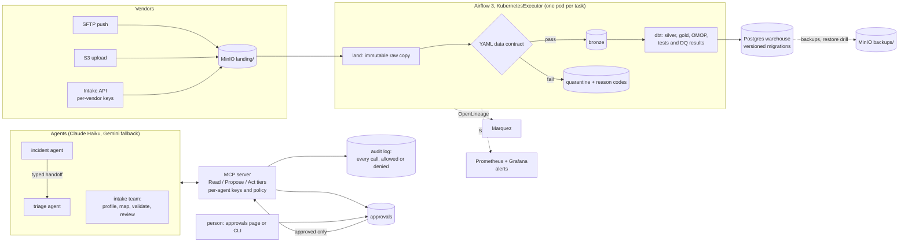

# Architecture, on one page

A data intake platform for healthcare and finance vendor feeds. Files arrive by SFTP, by S3
upload or through an HTTP API. Each is checked against a data contract, loaded into a medallion
warehouse, or quarantined with a machine-readable reason. A small team of AI agents watches the
platform: they diagnose incidents and propose fixes, and nothing changes until a person approves
it. Everything runs on Kubernetes locally (kind), on synthetic and public data only.

## How a file moves

1. **Land.** The file is copied to `raw/<feed>/<date>/<sha256><ext>` before anything else, and that
   copy is never changed, so any run can be replayed (`dip/intake.py`).
2. **Check.** Its feed's contract (`packs/*/contracts/*.yaml`: columns, types, patterns, an
   arrival schedule, a bad-row threshold) decides: load it, load it without the bad rows, or
   quarantine the whole file. Every reason is a code a person or an agent can act on.
3. **Build.** dbt turns bronze into silver, gold and an OMOP CDM, runs its tests, and records
   the data quality results the alerts and the agents read.
4. **Watch.** Lineage goes to Marquez, metrics to Prometheus, and failures, late feeds and
   quarantines open incidents in `ops.incident`.
5. **Fix.** The incident agent diagnoses an incident from read-only tools, hands a typed
   diagnosis to the triage agent, and the triage agent proposes an action (ask the vendor to
   resend, replay or discard quarantined rows, or a contract change as a pull request). A person
   approves it on the approvals page. Only then can the proposing agent carry out a resend,
   replay or discard, and only that exact payload; a contract change is merged by a person.

## Guardrails on the agents

- **Tiers.** Read tools have no side effects. Propose tools write a request. Act tools run only
  an approval a person granted, unexpired, whose payload hash matches what was proposed
  (`dip/agents/registry.py`, `agents/policies/*.yaml`).
- **Everything is audited.** One row per tool call, allowed or denied, with hashes of the
  arguments and the result, never the data itself.
- **Limits that fail closed.** A spend cap per run and per calendar month counted from
  `ops.model_call` (24.3), a kill switch that refuses every agent write (24.8), chain ids signed
  by the platform (24.10). The runners' own least-privilege warehouse login is next (24.9).
- **Evals in CI.** Recorded model turns replay on every push. A changed prompt, tool or tool
  result fails the replay, so CI never calls a model and never drifts silently.

## How it scales, and where it breaks

Measured so far (the kind cluster on a GitHub runner, 15.6 GiB):

| What | Measured |
| --- | --- |
| Whole platform, peak memory during the E2E | 5.0 GiB (run 42617546697) |
| Restore drill: download, restore, verify one table | 2.4 s (run 42623049816) |
| Live agent eval, 8 cases | $0.0354 a run (run 41618947945) |

Proof at scale is **Stage 19, not built yet**: 100k and 1M synthetic members, incremental dbt
models and partitioned gold tables, a load test, and `docs/benchmarks.md`. Until then, these are
the limits the design already shows:

- **One Postgres** holds Airflow's metadata, the warehouse and Marquez (it saves about 600 MB
  on a laptop). It is the first thing to split under real load.
- **dbt rebuilds** the gold tables in full on every run. Fine at demo size; Stage 19 makes the
  large models incremental.
- **Files are read into memory** by the intake task. The channels cap them (the API at 20 MiB,
  SFTP at 50 MiB) and so do some formats (PDF 20 MiB, X12 50 MiB, Excel by its unzipped size),
  but a CSV dropped straight into MinIO has no cap of its own. Bigger files need streaming.
- **The intake API has no backpressure** yet: a flood of uploads queues in MinIO (16.1).

## The main trade-offs

| Choice | Why | Where it is decided |
| --- | --- | --- |
| A code supervisor, not a model, routes between agents | Deterministic, testable handoffs; a model never picks who acts | [PLAN.md §4.1](../PLAN.md#41-supervisor-model-for-agent-handoffs) |
| One contract-author agent for drift and onboarding | One prompt and eval set to keep honest | [PLAN.md §4.2](../PLAN.md#42-one-contract-author-agent-for-both-schema-drift-and-feed-onboarding) |
| MCP over HTTP with per-agent API keys, OAuth later | Works in the cluster and from a laptop; keys are hashed at rest | [PLAN.md §4.3](../PLAN.md#43-streamable-http-with-api-keys-now-oauth-later) |
| Our own small contract engine, not a framework | Exact reason codes, row-level quarantine, no heavy dependency | [PLAN.md §2](../PLAN.md#data-contracts-yaml) |
| Recordings replayed in CI, live evals only by hand | $0 CI, deterministic evals; a monthly cap on live spend | PLAN.md decisions log, 2026-11-05 |
| Everything on one laptop-sized kind cluster | Free and reproducible; the README says "runs on Kubernetes locally" | [PLAN.md §5](../PLAN.md#5-ram-check-systeminfo-2026-10-17) |
| Versioned migrations at deploy, not DDL in every task | Per-task DDL deadlocked with the MCP server's queries | `docs/migrations.md`, PLAN.md decisions log |

More: the [README](../README.md) (quick start, what runs where, the production readiness
checklist), [PLAN.md](../PLAN.md) (the design record and every decision), and
[docs/incidents.md](incidents.md) (what broke and how it was fixed).
