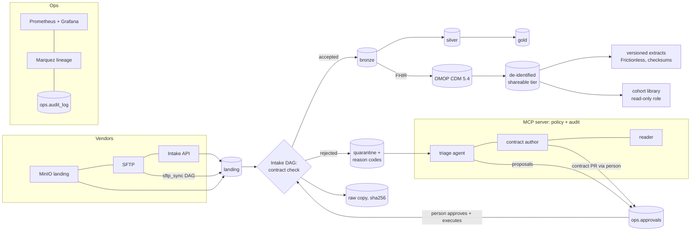

# For reviewers

This page maps the Data Engineer, Research Informatics role to what this repository
actually contains: the file, the PR that built it, and the result it produced. Every
number here is from a committed result or a CI run. Anything not built is marked
**planned**.

**Data.** Everything committed, and everything CI runs on, is synthetic (Synthea, and
generated or invented fixtures). Two public de-identified datasets (the MIMIC-IV demos,
ODbL) can be run locally only; they are never committed, and only aggregate results are
published ([docs/research/mimic.md](research/mimic.md)). No real or MIMIC data is ever sent
to a model provider.

## A two-minute tour

1. **The architecture** (diagram below): files arrive by MinIO, SFTP or an HTTP intake
   API; each is checked against a YAML data contract, then loaded bronze → silver → gold
   with dbt on Postgres, or quarantined with a reason code. FHIR goes on to an OMOP CDM 5.4
   gold layer, a de-identified shareable tier, and versioned research extracts.
2. **A contract:** [packs/healthcare/contracts/eligibility.yaml](../packs/healthcare/contracts/eligibility.yaml),
   and what each rule does: [docs/contracts.md](contracts.md).
3. **The research track:** FHIR → OMOP, data quality named after OHDSI DQD, de-identified
   tier, rebuild-verified extracts, lineage: [docs/research/README.md](research/README.md).
4. **Cohorts:** four versioned feasibility cohorts over the shareable tier, run only by a
   read-only role, with small-cell suppression and a hash-chained audit:
   [docs/research/cohort-service.md](research/cohort-service.md).
5. **The agents:** triage and contract authoring with human approval, and how they are
   evaluated: [docs/agents/EVALS.md](agents/EVALS.md).
6. **Proof it runs:** the GitHub Actions `e2e` workflow brings the whole stack up on kind
   (Kubernetes in Docker) and runs every end-to-end case on every push; `upgrade` deploys
   the previous version, loads data, upgrades in place and runs the E2E again.

## The role, line by line

| The role asks for | Evidence in this repo | Built in | Result |
|---|---|---|---|
| Research data pipelines integrating EHR data | Synthea FHIR R4 through a FHIR contract into bronze ([docs/research/README.md](research/README.md) R1); MIMIC-IV FHIR demo (Bulk Data) through the same intake, locally ([docs/research/mimic.md](research/mimic.md)) | #3, #11 | CI runs the FHIR flow end to end on every push |
| ...registries and external data | External vocabularies: the full OHDSI Athena bundle (local, never committed) and MIT-LCP's MIMIC lab → LOINC map ([docs/research/vocabulary.md](research/vocabulary.md)); the MIMIC-IV relational demo as a second external source with per-table contracts; payer eligibility and claims, AP invoices as Excel, PDF and scans. **No disease registry feed is built**; the per-table relational path is how one would be added | #12, #14, #18, #23–#26, #29, #32 | Unmapped rows: Synthea 6.8% → 0.1%, MIMIC diagnoses 100% → 3.3% with the full vocabulary |
| Research-ready datasets | OMOP CDM 5.4 gold layer (person, observation period, visit, condition, measurement, drug exposure, observation, procedure); a de-identified shareable tier; versioned Frictionless extracts ([docs/research/README.md](research/README.md) R2, R4, R5) | #4, #6, #7, #20 | Extracts proven byte-identical across independent rebuilds (`python -m dip extract verify`) |
| Longitudinal patient tracking | `observation_period` per person; cohorts that follow people over time (HbA1c re-tests, BMI a year later, a later kidney diagnosis) ([docs/research/cohort-service.md](research/cohort-service.md)) | #4, #27 | On 568 Synthea patients: 568 → 201 adults with BMI 30+ → 183 re-measured → 136 with a 5% lower BMI |
| Cohort identification, trial feasibility, real-world evidence | A versioned cohort library (`packs/healthcare/cohorts/*/v1.sql`) with attrition, small-cell suppression (1–10 and complementary differences), run as a read-only role, every run audited in a hash chain ([docs/research/cohort-service.md](research/cohort-service.md)) | #21, #27, #38 | Four cohorts; the attrition table is in the doc. The drift monitor's side (R7b) is **planned** in that repo |
| Documented definitions | YAML data contracts with every rule documented ([docs/contracts.md](contracts.md)); cohort definitions as versioned SQL with written criteria; OMOP concept ids in `config/omop_concepts.csv` | #16, #27 | |
| Quality checks | Contract checks with reason codes (row and file level); dbt tests named after OHDSI DQD checks with results in `ops.dq_results`; cross-source matching (PDF invoices to the Excel register) ([docs/research/README.md](research/README.md) R3) | #5, #16, #32 | DQ findings surfaced, e.g. 26% of 6,262 Synthea HbA1c results below 3% ([cohort-service.md](research/cohort-service.md)) |
| Metadata, lineage | OpenLineage events from intake, dbt and extracts to Marquez; dbt test results on each dataset ([docs/observability.md](observability.md)) | #8, #34 | CI's E2E walks Marquez from gold back to the intake run that read the landed file |
| FAIR reuse | Frictionless Data Package per extract: types, keys, checksums, provenance, license (CC0 for synthetic, ODbL with attribution for MIMIC-derived, enforced) ([docs/research/README.md](research/README.md) R5) | #7, #13 | |
| Governed, secure access | Postgres roles per consumer: researchers see only the shareable tier; the cohort reader is granted it only while the warehouse holds no MIMIC (classified live, sticky block); the metrics exporter has column grants; the MCP server has least-privilege DB, MinIO and Airflow logins and masks PHI for its reader; per-agent API keys; append-only audit log | #6, #21, #33, #35, #38 | Integration tests connect as each role and assert what it is refused |
| Reproducibility | Pinned versions everywhere (base images by digest; charts, images and packages by exact version, each at least two weeks old when chosen); deterministic generators and fixtures (byte-identical on rerun); rebuild-verified extracts; Terraform-built stack; CI E2E and an in-place upgrade job | #1, #7, #19 | `make up` / `scripts/up.sh` builds the stack from a clean machine; see the README |
| FHIR and OMOP | FHIR R4 bundles validated against a contract; OMOP CDM 5.4 with standard concepts from Athena; MIMIC built both from FHIR and from relational tables, then reconciled | #3, #4, #11–#13 | Reconciliation of the two MIMIC builds: 0 unexplained differences |
| Monitoring and operations | Prometheus alert rules (unit-tested with promtool), Grafana dashboards, late-file SLA incidents, 8 break-and-fix runbooks ([docs/runbooks](runbooks/README.md)) | #30, #33, runbooks PR | |
| An agentic layer with human approval and evals | A triage agent and a contract-author agent as MCP clients; per-agent policies enforced by the server; every proposal approved by a person; the contract author's changes become a local branch a person publishes; evals with recorded runs in CI ([docs/agents/EVALS.md](agents/EVALS.md)) | #28, #35, #37 | Triage: 7/7 held out, 33/36 over 3 live runs, 0 policy violations. Contract author: 35/36 over 3 live runs, 0 loosening errors, 0 PHI missed, no injection followed; Gemini 8/12 on the same cases |

## What is planned, not built

From [PLAN.md](../PLAN.md)'s stages: 837/835 claim and remittance files (Stage 4); running
each runbook's whole loop in the E2E (Stage 4); the agent-run Act tier (Stage 6: today a
person executes every approved action); the incident agent and the LangGraph handoff
(Stage 7); nightly evals and a recorded demo (Stage 8); R7b, the cohort service's side in
the drift monitor.
