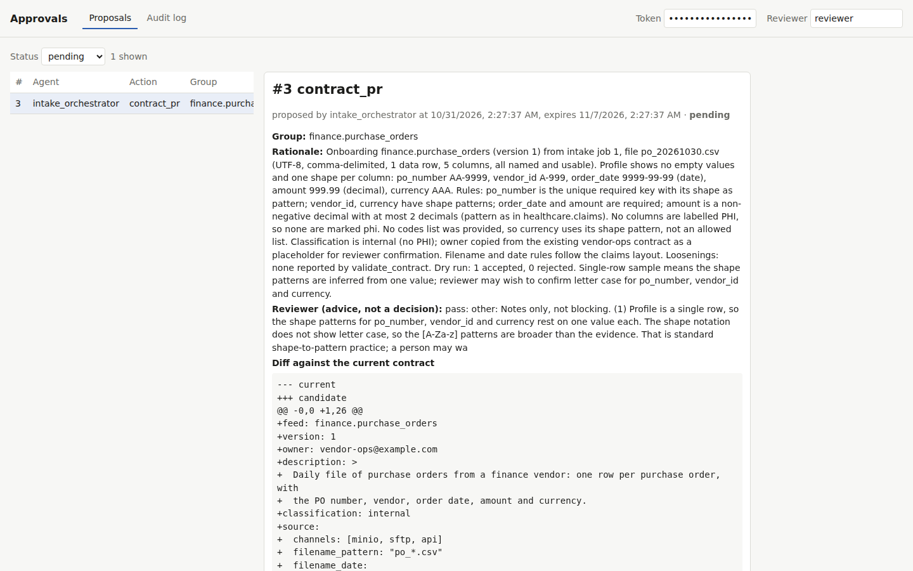
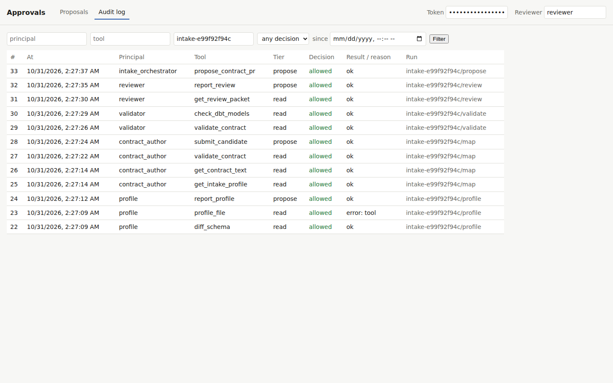

# Stage 10 demo: a new vendor's feed, from a sample to a contract branch

The stage's one proof with a model key, on 2026-10-31. It ran in the manual `proof`
workflow (`.github/workflows/proof.yml`, run 41159028750) on a GitHub runner, from
`s10-6-cluster` with `main` (#64) merged in. Two local attempts on the 16 GB laptop stopped
under 1 GB free: the kind node's `kubeadm init` was OOM-killed before any image loaded,
and the stack was torn down both times. The user then moved the proof to a runner (PLAN.md
decisions log). CI's kind E2E covers every Stage 10 item on every push.

```bash
gh workflow run proof.yml --ref s10-6-cluster -f spend_cap_usd=0.25
gh run download <run id> -n s10-6-proof    # the screenshots, results.md, audit.json
```

The workflow ran `up.sh` (core profile, **no model key**), `smoke.sh` and `e2e.sh`, which
spent nothing. Then `scripts/proof_intake.py` ran the intake team once, in the cluster:
a pod of the platform image running `dip.agents.intake_runner --limit 1` with the
agent_chain DAG's Secret, plus a Secret holding the key, made for the run and deleted after.
`DIP_SPEND_CAP_USD=0.25` stopped `AnthropicLLM` from sending any request that could pass the
cap. The cluster was torn down at the end.

| Check | Result |
|---|---|
| The oldest queued job is the E2E's onboarding job | job 1, `finance.purchase_orders`, `onboard` |
| The team claimed that one job and proposed | 1 claimed, `proposed`; every step on Claude (`profile:anthropic map:anthropic review:anthropic`) |
| Spend within the cap | **$0.0074** of $0.25 |
| Every step in the audit log under one chain id | 12 calls under `intake-e99f92f94c` by `profile`, `contract_author`, `validator`, `reviewer`, `intake_orchestrator` |
| Nothing written before the approval | proposal 3 `pending`, no branch |
| Screenshots | `intake-proposal.png` (in the README) and `intake-audit.png` |
| Approved, then executed | branch `contract/finance.purchase_orders-approval-3` |
| The branch holds the contract and its models | `packs/finance/contracts/purchase_orders.yaml`, `dbt/models/finance/purchase_orders/finance_purchase_orders_record.sql` and `_finance_purchase_orders.yml` |
| `dbt build` on those models, on the proof stack | PASS=11 WARN=0 ERROR=0 |

The reviewer's verdict was `pass`, with one note for the person: the sample has a single
row, so the shape patterns for `po_number`, `vendor_id` and `currency` rest on one value
each and may be broader than the vendor intends. The orchestrator carried this as advice
beside the decision.





## What the run found

- **`profile_file` returned a tool error** (audit row 23). The profile worker went on with
  `diff_schema` and the server-built profile, and `report_profile` succeeded. The
  proposal is unaffected. Why the tool erred on a one-row sample is not yet known; it is a
  follow-up.
- **Memory.** A kind node with the platform's images does not fit next to a desktop
  session on this 16 GB laptop. Runner-side proofs are the way from here on.
- Every input was synthetic (the E2E's invented purchase-order row).
